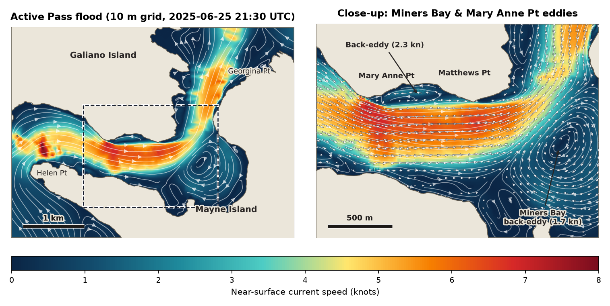
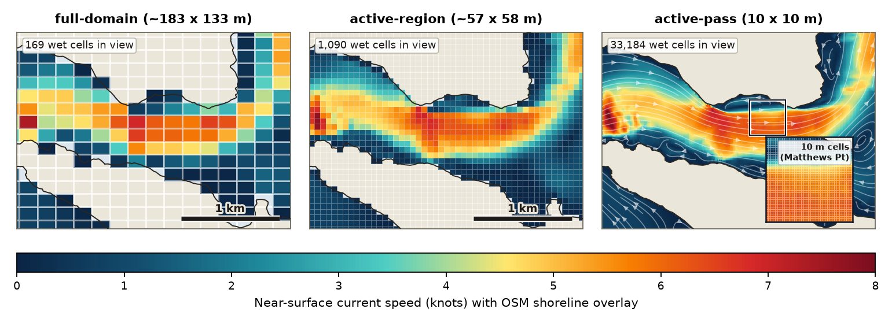
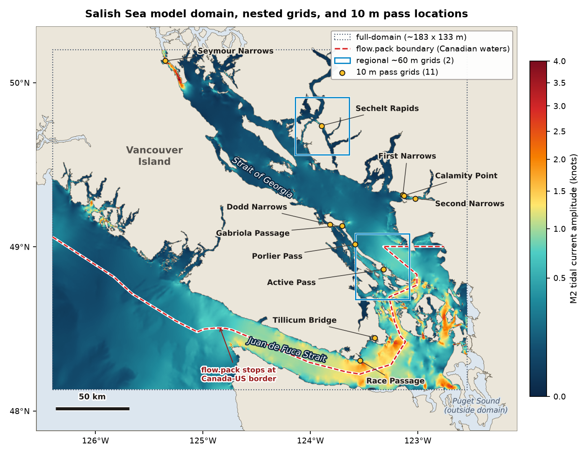
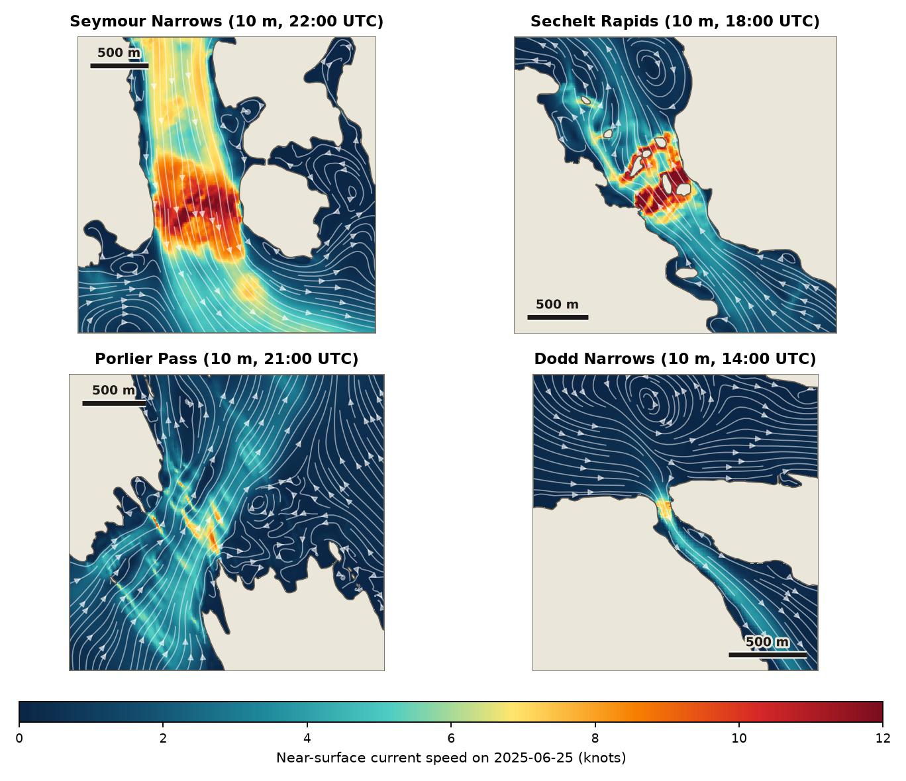

# salish-tides

Precomputed tidal current and tide-height weights for the Salish Sea, with a
single-file Python reader.

The Salish Sea covers the inland coastal waters of southwestern British
Columbia and northwestern Washington, including Juan de Fuca Strait, the
Strait of Georgia, and the San Juan and Gulf Islands. Tidal ranges reach about
5 metres and currents in the narrow passes can exceed 10 knots.

The weights in this repository store harmonic constants fitted from a 3D
[SCHISM](https://schism-dev.github.io/schism/) hydrodynamic model onto nested
grids from ~180 m in open water down to 10 m in the passes. Given a location
and timestamp, the reader evaluates the harmonic series directly, so lookups
work offline for any date without pre-generated tables or a network service.
This repository contains the exported weights, OpenStreetMap coastline
polygons, and Python reader. See [MODEL.md](MODEL.md) for the underlying
model setup and validation results.



```python
from datetime import datetime, timezone
from salish_tides import Pyramid, speed_and_bearing

model = Pyramid("weights/pyramid")
when = datetime(2025, 7, 4, 17, 0, tzinfo=timezone.utc)

east, north = model.current(-123.8171, 49.1344, when)   # Dodd Narrows, m/s
speed, toward = speed_and_bearing(east, north)
height = model.tide(-123.254, 49.337, when)             # Point Atkinson, m from mean water level
```

## Files

| Path | Description | Size |
|---|---|---:|
| `weights/pyramid/` | All 14 nested grids (currents, tide heights, depths) as JSON/zlib files, with `manifest.json` | 50 MB |
| `weights/flow.pack` | Currents only (Canadian waters), tiled in 32x32 blocks for fast random access | 24 MB |
| `weights/tide.pack` | Tide heights only on a single ~730 m grid | 0.4 MB |
| `weights/coast.pack` | OpenStreetMap land polygons simplified to four levels of detail | 7 MB |
| `salish_tides.py` | Single-file Python reader (`Pyramid`, `FlowPack`, `TidePack`, `Coast`) | |
| `examples/` | Example scripts for 12-hour currents, slack water, daily tide curves, and SVG charts | |
| `check.py` | Verifies SHA-256 checksums and cross-checks the readers against each other | |
| [FORMATS.md](FORMATS.md) | Binary and JSON format specifications for the weight and coastline files | |
| [MODEL.md](MODEL.md) | Model setup, surface-current scaling, validation metrics, and known issues | |
| [LICENSING.md](LICENSING.md) | License details and required attribution notices | |

`pyramid/`, `flow.pack`, and `tide.pack` all come from the same harmonic fit.
`Pyramid` decompresses every grid into memory up front and includes tide
heights, depths, raw constituent constants, and US waters. `FlowPack` only
inflates the 32x32 tile needed for a lookup, keeping memory usage low for
mobile or web apps. `TidePack` is a small single-grid export for applications
that only need water levels.



## Usage

Requires Python 3.9+ and `numpy`.

```sh
python check.py                                   # verify checksums and reader agreement
python examples/current_now.py                    # Active Pass currents for the next 12 hours
python examples/slack_water.py -123.8171 49.1344  # Dodd Narrows slack times and peak speeds today
python examples/tide_curve.py -123.371 48.424     # Victoria tide curve today
python examples/chart_svg.py                      # write chart.svg for Active Pass
```

- `current(lon, lat, when)` (on `Pyramid` and `FlowPack`) returns
  `(east, north)` in m/s toward the direction of flow, or `None` if the cell
  is dry or out of bounds.
- `tide(lon, lat, when)` (on `Pyramid` and `TidePack`) returns water height in
  metres relative to mean water level, or `None`.
- `speed_and_bearing(east, north)` converts `(east, north)` velocity
  components into `(speed_m_s, bearing_deg_true)`. `KNOTS_PER_M_S`
  (`1.943844`) is also exported.

`when` accepts a `datetime` (naive datetimes are treated as UTC) or Unix
seconds. West longitudes are negative. `Pyramid` and `FlowPack` check grids
from finest to coarsest and return the value at the nearest node of the finest
grid that covers `(lon, lat)` and has water at that cell, without spatial
interpolation.

To inspect the raw harmonic constituents (`M2`, `S2`, `N2`, `K1`, `O1`, `Q1`,
`P1`) rather than evaluating a timestamp, look up the active `Grid` on a
`Pyramid` via `grid = model.grid_at(lon, lat)` and call
`grid.constants(lon, lat, field="current")` or `field="tide"`.

`Coast("weights/coast.pack")` reads the OpenStreetMap land polygons at four
simplification levels (`0` is ~1 m, `3` is ~891 m). `coast.rings(level)`
yields `(lon, lat)` polygon arrays for drawing, and `coast.is_land(lon, lat)`
tests whether a point falls on land. The coastline polygons are for map
rendering and are finer than the model's wet/dry grid cells.

## Coverage

The domain runs from 126.40 W to 122.54 W and 48.13 N to 50.20 N, covering
Juan de Fuca Strait, Haro and Rosario Straits, the San Juan and Gulf Islands,
the Strait of Georgia, Burrard Inlet, Howe Sound, Sechelt Inlet, and Discovery
Passage north to Brown Bay. Puget Sound south of Admiralty Inlet is not
covered.



Eleven passes have dedicated 10 m grids (Seymour Narrows, Sechelt Rapids, Dodd
Narrows, Gabriola Passage, Porlier Pass, Active Pass, First Narrows, Second
Narrows, Calamity Point, Tillicum Bridge, and Race Passage). Two ~60 m
regional grids cover the Active Pass and Sechelt areas, and a ~180 x 130 m
grid covers the rest of the domain. `weights/pyramid/` and `weights/tide.pack`
include both Canadian and US waters, while `weights/flow.pack` masks out US
cells at the border.



## Notes and limitations

- **Near-surface currents:** Velocities represent roughly the top 5 m of the
  water column. Depth-averaged model flows are scaled cell by cell using a
  log-layer factor (1.04 to 1.25) fitted to 3D vertical profiles. In deep
  stratified straits this overpredicts upper-layer speeds by around 10% (see
  [MODEL.md](MODEL.md)).
- **Astronomical tides only:** Predictions exclude wind, atmospheric pressure,
  storm surge, river discharge (such as the Fraser River freshet), and
  stratification. Actual water levels commonly differ by tens of centimetres,
  and more in storms.
- **Mean water level datum:** Tide heights are referenced to mean water level,
  not chart datum. Add a station's mean water level offset above chart datum
  when comparing against tide tables.
- **No nodal corrections:** Each grid stores 7 constituents (`M2`, `S2`, `N2`,
  `K1`, `O1`, `Q1`, `P1`) fitted to a 2025 run without 18.6-year lunar nodal
  adjustments, introducing an amplitude error of a few percent in other years.
- **Accuracy:** Against gauges and CHS reference tables ([MODEL.md](MODEL.md)),
  Strait of Georgia `M2` tide phases are within a few degrees (minutes),
  diurnal amplitudes (`K1`, `O1`) run 10-15% low, and pass currents turn about
  10 minutes early on average. Peak `M2` speeds at 8 of the 10 reference
  passes are within 20% of published tables, with larger errors at Seymour
  Narrows and Tillicum Bridge.

**Do not use for navigation.** This is a research dataset with known errors
and no warranty. Use official publications such as the Canadian Tide and
Current Tables or NOAA tide and current predictions.

## Version

Current release: `2026-11-06`. Releases are tagged by export date as the model
is updated. Run parameters and harmonic fit metadata are recorded in
[MODEL.md](MODEL.md) and `weights/pyramid/manifest.json`.

## License

Code, coastline data, and model weights carry separate licenses due to
upstream data terms (see [LICENSING.md](LICENSING.md) for full details and
required notices):

- **Code** (`salish_tides.py`, `check.py`, `examples/`): [MIT](LICENSE).
- **Coastline** (`weights/coast.pack`): Open Database License 1.0 (ODbL),
  (c) OpenStreetMap contributors.
- **Model weights** (`weights/pyramid/`, `weights/flow.pack`,
  `weights/tide.pack`): Creative Commons Attribution-NonCommercial 4.0
  (CC BY-NC 4.0), due to non-commercial restrictions on the upstream
  bathymetry and boundary-tide data.

This product is not to be used for navigation. It contains data that is
intellectual property of the Canadian Hydrographic Service, Department of
Fisheries and Oceans Canada. See [LICENSING.md](LICENSING.md) for the full
required notice.
